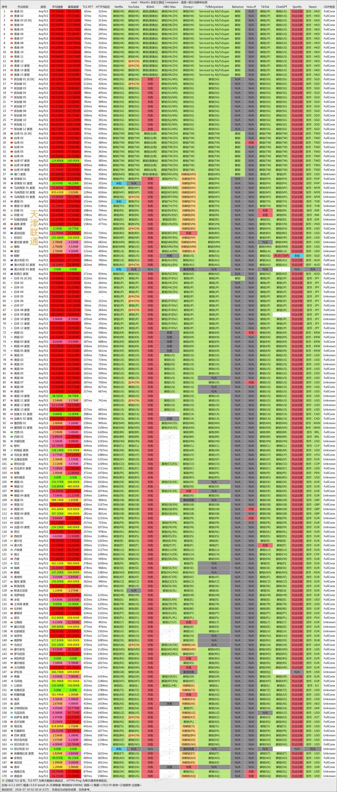
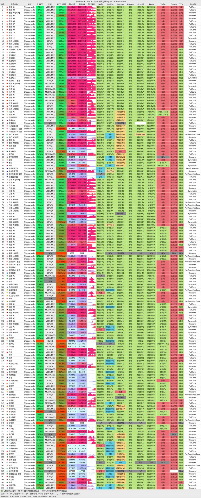

🇨🇳 中文 | 🇺🇸 [English](README_EN.md) | 🇷🇺 
[Русский](README_RU.md) | 🇮🇷 [فارسی](README_FA.md)

# Mesl专线机场官方地址(2026年11月11日更新)
Mesl专线机场官网地址</br>
最新地址01：[panel.meslcloud.com](https://to.iix.im/mesl03)</br>
最新地址02：[in.mesl.cloud](https://to.iix.im/mesl02)</br>
官方地址：[getmesl.com](https://to.iix.im/mesl01)</br>

2026最新好用的机场推荐与节点分享：[https://github.com/jdnei/JiChangTuiJian](https://github.com/jdnei/JiChangTuiJian)</br>
## Telegram VPN 机场福利社 #AD
[机场抽奖群](https://331024.de/archives/choujiang)｜[机场聊天群](https://331024.de/archives/choujiang)｜[机场体验群](https://331024.de/archives/choujiang)</br>

[https://331024.de/archives/choujiang](https://331024.de/archives/choujiang)
## 邀请码
```bash
xoXPahnO
```
## 简介
MESL Cloud 是一家创立于2022年的网络加速服务商，主打 BGP、IPLC、IEPL 专线中继，提供全球170多个节点及部分家宽、商宽 IP。节点覆盖香港、日本、新加坡、美国及欧洲等多个地区，支持流媒体和 AI 工具，适合日常上网、高清视频、跨境办公及多地区访问需求。
## 优势
MESL 的主要优势是专线网络与全球节点资源丰富，采用多运营商 BGP 入口及 IPLC、IEPL 中继，部分线路标称最高10Gbps带宽。提供家宽、商宽及低倍率节点，支持 Netflix、Disney+、ChatGPT 等服务。套餐覆盖轻量到大流量需求，支持5台设备同时在线，另有新疆优化套餐。
## 套餐

| 套餐 | 流量 | 价格 | 付款周期 | 同时在线设备 | 线路 / 带宽 | 节点数量 | 流媒体 / AI 解锁 | 特色 / 备注 |
|---|---|---|---|---|---|---|---|---|
| Premium 50G | 50GB / 月 | ¥155 / 年（约¥12.92/月） | 年付 | 5 台 | BGP + IPLC + IEPL，最高10Gbps | 170+ 全球节点及家宽节点 | Netflix 4K、Disney+、HBO Max、ChatGPT Plus、动画疯、TikTok | 每月账单日重置流量 |
| Premium 100G | 100GB / 月 | ¥72 / 季（约¥24/月） | 季付 | 5 台 | BGP + IPLC + IEPL，最高10Gbps | 170+ 全球节点及家宽节点 | Netflix 4K、Disney+、HBO Max、ChatGPT Plus、动画疯、TikTok | 每月账单日重置流量 |
| Premium 200G | 200GB / 月 | ¥50 / 月 | 月付 | 5 台 | BGP + IPLC + IEPL，最高10Gbps | 170+ 全球节点及家宽节点 | Netflix 4K、Disney+、HBO Max、ChatGPT Plus、动画疯、TikTok | 每月账单日重置流量 |
| Premium 300G | 300GB / 月 | ¥70 / 月 | 月付 | 5 台 | BGP + IPLC + IEPL，最高10Gbps | 170+ 全球节点及家宽节点 | Netflix 4K、Disney+、HBO Max、ChatGPT Plus、动画疯、TikTok | 每月账单日重置流量 |
| Premium 500G | 500GB / 月 | ¥110 / 月 | 月付 | 5 台 | BGP + IPLC + IEPL，最高10Gbps | 170+ 全球节点及家宽节点 | Netflix 4K、Disney+、HBO Max、ChatGPT Plus、动画疯、TikTok | 每月账单日重置流量 |
| Premium 1024G | 1024GB / 月 | ¥210 / 月 | 月付 | 5 台 | BGP + IPLC + IEPL，最高10Gbps | 170+ 全球节点及家宽节点 | Netflix 4K、Disney+、HBO Max、ChatGPT Plus、动画疯、TikTok | 每月账单日重置流量 |
| Premium Team | 3072GB / 月（3TB） | ¥599 / 月 | 月付 | 20 台 | BGP + IPLC + IEPL，最高10Gbps | 170+ 全球节点及家宽节点 | Netflix 4K、Disney+、HBO Max、ChatGPT Plus、动画疯、TikTok | 团队套餐；每月账单日重置流量 |
| Premium Enterprise Service | 1000GB / 月 | ¥1000 / 月（展示价） | 月付 / 定制 | 按需定制 | 独享入口、独享落地、家宽、5G蜂窝网络可选 | 按需定制 | 按定制内容提供指定服务解锁 | 定制服务¥500/月起；可提供99.9% SLA；购买前需提交工单 |
| 新疆优化 100G | 100GB / 月 | ¥35 / 月 | 月付 | 5 台 | IEPL 专线 | 新疆及部分特殊网络地区适用 | Netflix、Disney+、HBO、ChatGPT、DAZN、TikTok | 针对新疆及部分网络受限地区优化；其他地区用户勿买 |
| 新疆优化 200G | 200GB / 月 | ¥60 / 月 | 月付 | 5 台 | IEPL 专线 | 新疆及部分特殊网络地区适用 | Netflix、Disney+、HBO、ChatGPT、DAZN、TikTok | 针对新疆及部分网络受限地区优化；其他地区用户勿买 |

### 套餐说明

- **流量重置：** Premium 常规套餐每月账单日重置流量，年付和季付套餐也按月重置。
- **网络线路：** Premium 常规套餐采用 BGP、IPLC、IEPL 专线中继，商家标称最高10Gbps带宽。
- **全球节点：** Premium 常规套餐提供170+全球节点及部分家宽节点。
- **设备限制：** 普通套餐支持5台设备同时在线，Premium Team 支持20台。
- **企业定制：** Premium Enterprise Service 提供独享入口、独享落地、家宽及5G蜂窝网络等定制选项，实际价格与服务内容需联系客服确认。
- **新疆优化：** 新疆优化套餐采用IEPL专线，仅面向新疆及部分网络受限地区用户。
  
## 📊 性能实测与分析
#### 1.1电信晚高峰测速表现
</br>
#### 1.2联通晚高峰测速表现
</br>
#### 1.3移动晚高峰测速表现
</br>
#### 2.1AI解锁报告
</br>
#### 2.2流媒体解锁报告
</br>
#### 3.落地入口分析
</br>
